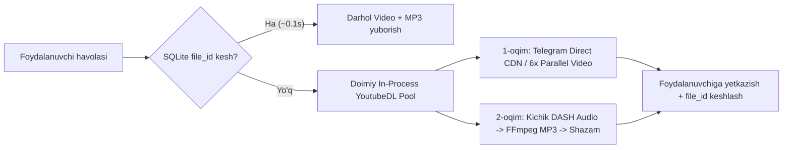

# 🎵 Tarona Izla — Yuqori Tezlikdagi Media va Musiqa Telegram Boti

**Tarona Izla** (`@taronaizlauzbot`) — Instagram Reels, TikTok va YouTube / Shorts platformalaridan video va videodagi musiqani **MP3** ko'rinishida tezkor yuklab beruvchi, **Shazam** orqali qo'shiqni aniqlab uning **to'liq studiya MP3** talqinini topuvchi hamda **Pro Admin Panel 2.0** boshqaruv markaziga ega Telegram bot.

---

## ✨ Asosiy Imkoniyatlar

### 👤 Foydalanuvchilar uchun
- **📸 Instagram Reels / 🎵 TikTok / ▶️ YouTube & Shorts:** Havola yuborilganda bir necha soniyada videoni hamda videodagi ovozni **MP3** formatda taqdim etadi.
- **🎧 Shazam Musiqa Aniqlash:** Videodagi yoki yuborilgan ovozli xabar (`voice`), audio va videodagi qo'shiq nomini, ijrochisini va albomini avtomatik aniqlaydi.
- **💿 To'liq Qo'shiqni Yuklash (Full MP3):** Aniqlangan musiqaning to'liq studiya talqinini bitta tugma orqali yuklab beradi.
- **🔍 Qo'shiq Nomi bo'yicha Qidiruv:** Foydalanuvchi qo'shiq yoki ijrochi nomini yozsa, top-5 natijani chiqarib tanlanganini MP3 formatda yuboradi.
- **⚡ Lahzalik Kesh (`file_id`):** Avval yuklangan video va taronalar Telegram `file_id` keshi orqali `~0.1` soniyada qayta yuklanmasdan uzatiladi (server diskida media fayllar saqlanmaydi).

### 👑 Pro Admin Panel 2.0 (`/admin`)
- **📊 Chuqur Analitika:** DAU / WAU / MAU, bugungi va kechagi o'sish farqi, kesh samaradorligi, 7 kunlik vizual grafik, jonli faollik oqimi hamda bazani **CSV / TXT** formatda eksport qilish.
- **🎛 Jonli Boshqaruv (Runtime Feature Flags):** Botni qayta ishga tushirmasdan texnik ishlar rejimini yoqish, alohida platformalarni (`Instagram`, `TikTok`, `YouTube`, `Shazam`, `Qidiruv`) yoqib-o'chirish, parallel yuklashlar (`MAX_CONCURRENT`) va anti-spam limitlarini sozlash, video/audio ostiga **reklama imzosi (Footer)** va `/start` matnini o'rnatish.
- **📢 Pro Rassilka:** Fonda ishlovchi tarqatish tizimi — auditoriya segmenti (`Hammaga`, `24s faollar`, `7k faollar`), `Copy` yoki `Forward` rejimi, URL inline tugmalar qo'shish, o'ziga test yuborish, **Pauza / Davom / To'xtatish** va rassilkalar tarixi.
- **🔒 Homiy Kanallar 2.0 (OPM):** Kanaldan post forward qilish orqali oson ulash, tashqi homiy havolalar (Instagram/sayt/bot), obuna limiti (`target_joins` yetganda avtomatik pauza), konversiya sanagichi va **Health Check**.
- **👥 Foydalanuvchilar CRM:** ID, `@username`, ism yoki forward xabar orqali qidirish, Top-10 faollar, oxirgi qo'shilganlar, to'g'ridan-to'g'ri xabar yuborish (DM) va sababli Ban / Unban.
- **🔗 Reklama / UTM Havolalar:** `?start=ref_...` maxsus havolalar yaratish va har bir manbadan kirgan obunachilar hamda yuklashlar konversiyasini kuzatish.
- **🖥 Tizim Monitoringi va Backup:** CPU, RAM, Disk, Uptime, faol jarayonlar, xatolar jurnali (`error_logs`), 1-bosishda SQLite `.db` Backup va masofaviy Restart.
- **🛡 Adminlar va Audit Log:** Panel ichidan yangi admin qo'shish/o'chirish va barcha admin harakatlari jurnali.

---

## 🚀 Turbo Arxitektura



- **Subprocess xarajati yo'q:** `yt-dlp` har so'rovda yangi jarayon ochmasdan xotiradagi doimiy ob'ektlar pulida (`_YdlPool`) ishlaydi.
- **Telegram Direct CDN + Parallel Range:** Instagram progressiv MP4 oqimlari to'g'ridan-to'g'ri Telegram serverlari orqali uzatiladi; lokal yuklashlarda `aiohttp` orqali 6 ta parallel HTTP `Range` oqimi ishlatiladi.
- **Nol disk to'lishi:** Har bir so'rov uchun ochilgan vaqtinchalik papka `finally` blokida darhol tozalanadi.
- **Polling va Webhook:** Ham oddiy **Long Polling** (lokal/VPS), ham **aiohttp Webhook** + **Low-RAM (`256 MB`)** rejimlarida ishlaydi.

---

## 📂 Loyiha Tuzilmasi

| Fayl | Vazifasi |
|------|----------|
| `bot.py` | Asosiy Telegram bot routeri, parallel media konveyeri, Polling va Webhook serveri |
| `downloader.py` | Turbo yuklash dvigateli (`YoutubeDL` pool, 6x parallel `aiohttp`, FFmpeg konvertatsiya, qidiruv) |
| `recognizer.py` | `ShazamIO` asosida audio/ovozdan musiqani aniqlash moduli |
| `admin.py` | Pro Admin Panel 2.0 barcha bo'limlari va FSM holatlari |
| `admin_utils.py` | Admin klaviaturalari, OPM 2.0 parallel/keshli tekshiruvi, CSV eksport va SQLite backup |
| `database.py` | Doimiy `aiosqlite` ulanishi, avtomatik migratsiyalar, analitika va jadvallar boshqaruvi |
| `runtime.py` | Dinamik parallel yuklash slotlari, anti-spam rate limiter, tizim metrikalari va xato xabarnomalari |
| `config.py` | `.env` sozlamalari va standart boshqaruv parametrlari |
| `Dockerfile` / `Procfile` | Konteyner va PaaS muhitlari uchun konfiguratsiya |
| `deploy_alwaysdata.sh` | Alwaysdata (Webhook + Low-RAM) 1-buyruqli o'rnatish skripti |
| `deploy_oracle.sh` / `deploy_aws.sh` | Oracle Cloud va AWS Ubuntu VPS uchun `systemd` 24/7 o'rnatish skriptlari |

---

## ⚙️ O'rnatish va Ishga Tushirish

### 1. Talablar
- **Python 3.11+**
- **FFmpeg** (`winget install ffmpeg` yoki `sudo apt install ffmpeg`)

### 2. Loyihani yuklab olish va sozlash

```bash
git clone https://github.com/ZiyodullaOtabaev/tarona-izla-bot.git
cd tarona-izla-bot

python -m venv venv
# Windows:
venv\Scripts\activate
# Linux / macOS:
source venv/bin/activate

pip install -r requirements.txt
cp .env.example .env
```

`.env` faylini ochib o'z ma'lumotlaringizni kiriting:

```env
BOT_TOKEN=1234567890:AAHxxxxxxxxxxxxxxxxxxxxxxxxxxxxx
PRIMARY_ADMIN_ID=123456789
ADMIN_USERNAMES=sizning_username
```

### 3. Ishga tushirish (Long Polling)

```bash
python -u bot.py
```
*(Windows'da `run.bat` faylini ishga tushirish ham mumkin.)*

---

## ☁️ Serverga Deploy Qilish

### Docker orqali
```bash
docker build -t tarona-izla .
docker run -d --restart always --env-file .env --name tarona-bot tarona-izla
```

### Ubuntu / Oracle Cloud / AWS VPS (24/7 `systemd`)
```bash
bash deploy_oracle.sh
# yoki AWS uchun:
bash deploy_aws.sh
```

### Alwaysdata (Webhook + Low-RAM `256 MB`)
1. Fayllarni serverga yuklab, SSH orqali ishga tushiring:
   ```bash
   bash deploy_alwaysdata.sh
   ```
2. Alwaysdata panelida **Web → Sites → Edit** bo'limida:
   - **Type:** `User program`
   - **Command:** `/home/<account>/tarona-izla/venv/bin/python -u /home/<account>/tarona-izla/bot.py`
   - **Working directory:** `/home/<account>/tarona-izla`

---

## 🔐 Muhit O'zgaruvchilari (`.env`)

| O'zgaruvchi | Majburiy | Tavsifi |
|-------------|----------|---------|
| `BOT_TOKEN` | Ha | `@BotFather` bergan Telegram bot tokeni |
| `PRIMARY_ADMIN_ID` | Ha | Asosiy admin (Ega) Telegram raqamli ID si |
| `ADMIN_IDS` | Yo'q | Qo'shimcha admin ID lar (vergul bilan) |
| `ADMIN_USERNAMES` | Yo'q | Qo'shimcha admin username'lar (vergul bilan) |
| `LOW_RAM_MODE` | Yo'q | `1` bo'lsa 256 MB RAM serverlar uchun tejamkor rejim yoqiladi |
| `FFMPEG_PATH` | Yo'q | Maxsus `ffmpeg` yo'li (bo'sh bo'lsa tizim `PATH` dan qidiradi) |
| `WEBHOOK_HOST` | Yo'q | Webhook domeni (`https://example.com`); bo'sh bo'lsa Polling ishlaydi |
| `WEBHOOK_PATH` | Yo'q | Webhook yo'li (standart: `/webhook`) |
| `WEBHOOK_SECRET` | Yo'q | Telegram Webhook xavfsizlik tokeni |

---

## 📄 Litsenziya

Ushbu loyiha ochiq manbali dasturiy ta'minot sifatida taqdim etilgan.
